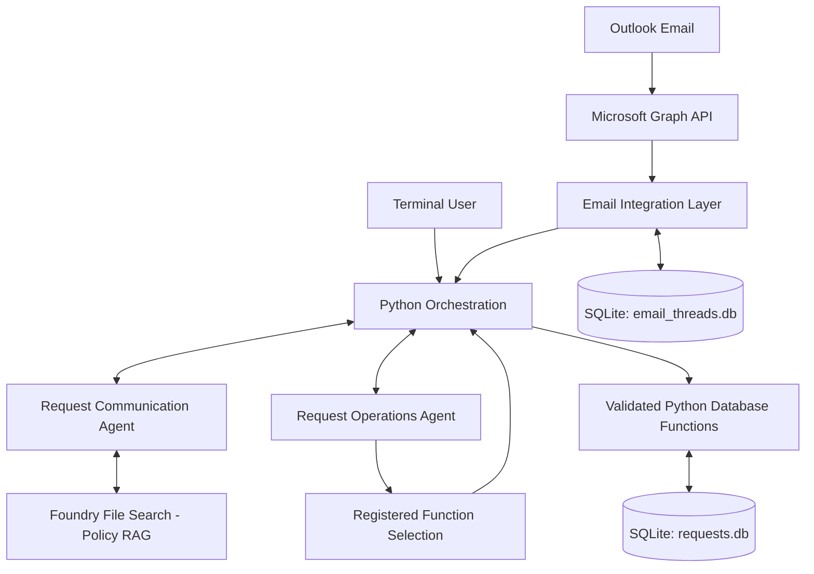

# Agentic AI Enterprise Request Management System

**A two-agent IT request-management system built using Microsoft Foundry, GPT-5 Mini, Python, SQLite, Microsoft Outlook, Microsoft Graph API, function calling, and Retrieval-Augmented Generation (RAG).**

The project demonstrates how AI agents can interpret natural-language requests, manage multi-step interactions, and support operational workflows while keeping database execution under controlled application logic.

## Project Status

**Functional local portfolio prototype — last updated November 18, 2026.**

The project has successfully demonstrated two interaction channels:

**1. Conversational Request Management (Terminal)**

- End-to-end CREATE, UPDATE, GET, CANCEL, and LIST workflows.
- Natural-language intent understanding and request drafting.
- Semantic duplicate detection.
- Explicit confirmation before database modifications.
- Policy question answering through a configured Foundry File Search knowledge source.
- Independent SQLite verification of completed operations.

**2. Outlook Email Request Management**

- Email intake through Microsoft Graph API.
- Multi-turn conversation tracking and draft persistence.
- AI-powered field extraction and missing-information collection.
- Email-based request review and confirmation.
- Controlled self-service identity verification.
- Semantic duplicate screening.
- Durable CREATE execution tracking.
- Successful request creation through the Operations Agent.
- Independent database verification.

**Verified results:**

- 8/8 original orchestration regression tests passed.
- 8/8 email CREATE execution-ledger tests passed.
- Terminal-based end-to-end lifecycle completed on November 9, 2026.
- Outlook-to-SQLite CREATE completed successfully on November 18, 2026.

**Important:** This is a working portfolio prototype, not a production-deployed enterprise service desk. The Outlook integration uses supervised execution rather than continuous automated inbox processing.

---

## 1. Project Overview

Enterprise IT request management frequently involves repetitive manual activities such as collecting requester information, identifying request categories, checking existing requests, tracking statuses, and explaining organizational policies.

Requests may arrive through conversational interfaces or unstructured emails. These often require follow-up questions before the request can be processed.

This project explores how multiple AI agents can work together to simplify these activities.

Rather than requiring users to follow rigid forms, the system interprets requests expressed in natural language and prepares structured information for operational processing.

For example, a user might say:

> "I need access to Copilot Studio with High priority."

The system can:

1. Understand the user's request and identify the intent.
2. Generate an appropriate request title.
3. Identify the request category.
4. Extract available request details.
5. Collect missing mandatory information.
6. Retrieve existing requests and identify possible duplicates.
7. Present the request for confirmation.
8. Validate the confirmed operation.
9. Execute the appropriate registered function.
10. Verify the saved database record.

The system also supports request modification, cancellation, status retrieval, request listing, and policy-related questions through its terminal interface.

### Outlook Email Integration

The project extends conversational request management to Outlook email.

For example, a requester can email:

> "Hello IT Team, please create a request for an ergonomic keyboard for my workstation."

The Communication Agent extracts the available information and identifies missing fields.

If a requester email is missing, the user can provide it in a subsequent email within the same conversation.

The system retains information collected previously, updates the draft, checks for duplicate requests, and prepares a confirmation email.

After a valid confirmation and authorization checks, the request can be submitted through the Operations Agent using a supervised execution step.

This demonstrates how the same agent architecture can support multiple communication channels without requiring separate business logic for each interface.

---

## 2. Key Features

### 2.1 Natural-Language Request Management

The Request Communication Agent interprets natural-language messages, extracts relevant information, and helps maintain context across conversations.

The terminal application supports:

- Create a new request.
- Check request status.
- List existing requests.
- Update an existing request.
- Cancel an existing request.
- Ask questions about IT policies.

The Outlook integration currently supports a supervised **CREATE workflow**.

Email-based UPDATE, CANCEL, and continuous mailbox monitoring are outside the implemented demonstration scope.

### 2.2 Intelligent Request Drafting

The Communication Agent generates suitable request titles based on the user's description.

For example:

**User input:**

> "I need Adobe Acrobat Pro access."

**Possible generated title:**

> "Adobe Acrobat Pro access"

The user does not need to supply an exact request title.

The system collects mandatory request information:

- Requester name
- Requester email
- Request title
- Request description
- Request type
- Priority

Supported priority values are:

- Low
- Medium
- High
- Critical

Priority must be present and valid before the supervised email CREATE operation is executed. The November 18 demonstration used an explicitly supplied Medium priority.

The earlier terminal prototype contains a legacy Medium-priority fallback that should be removed before claiming strict no-default behavior across every entry channel.

### 2.3 Multi-Agent Orchestration

The architecture uses **two specialized GPT-5 Mini agents** created in Microsoft Foundry.

#### Request Communication Agent

Responsible for:

- Natural-language understanding
- Intent identification
- Conversation handling
- Follow-up questions
- Request title drafting
- Structured information extraction
- Email reply interpretation
- Request confirmation interpretation
- Semantic duplicate comparison
- Policy question answering through RAG

#### Request Operations Agent

Responsible for selecting the appropriate registered operational function:

- `create_request_auto`
- `get_request`
- `list_requests_by_email`
- `update_request`
- `cancel_request`

The Operations Agent selects a registered function and supplies structured arguments.

Python validates the selected operation, executes the corresponding local function, and verifies the database result.

The agents do not directly execute arbitrary database queries.

**Architecture principle:** Language understanding and operational tool selection are handled by the agents. Workflow coordination, authorization checks, business-rule validation, and database execution are controlled by Python.

### 2.4 Outlook Email Integration

Microsoft Graph API connects the system to a personal Outlook account through a Microsoft Entra application registration.

The integration uses MSAL authentication and delegated permissions for reading and sending email.

Implemented capabilities include:

- Read messages from an Outlook mailbox.
- Identify messages belonging to the same conversation.
- Extract requester information using the Communication Agent.
- Preserve request drafts across multiple replies.
- Track processed messages to avoid processing the same message repeatedly.
- Generate and send acknowledgment or confirmation emails.
- Interpret confirmation replies.
- Check the authenticated Outlook account against the requester email for the restricted self-service demo.
- Submit a confirmed request through the existing Operations Agent after separate terminal approval.

The email interface reuses the existing agents instead of creating additional specialized email agents.

### 2.5 Persistent Email Conversation State

The email integration uses a separate SQLite database named `email_threads.db`.

This database maintains:

- Email conversation state.
- Processed-message information.
- Request drafts.
- Confirmation proposals.
- Confirmation decisions.
- CREATE execution attempts.

This allows the application to preserve request information across separate Python executions.

For example, the ergonomic-keyboard demonstration initially captured the requester name, priority, title, description, and category.

When the requester supplied the missing email address in a later reply, the application retained the previous fields and completed the draft.

### 2.6 Semantic Duplicate Detection

Traditional duplicate detection may overlook requests expressed using different wording.

For example:

**Existing request:**

> "Power BI Desktop access"

**New request:**

> "I need permission to use Power BI."

The system retrieves active requests associated with the supplied requester email.

The Communication Agent compares the requested resource, meaning, and intended outcome.

Comparison outcomes include:

- `DUPLICATE`
- `POSSIBLE_DUPLICATE`
- `DISTINCT`

Python validates the comparison results and blocks duplicate or unresolved possible-duplicate submissions.

The Outlook integration performs read-only duplicate screening before preparing a confirmation and again before CREATE execution.

Duplicate detection is limited to the records available to the application and is not a transactional guarantee against simultaneous submissions.

### 2.7 Explicit Confirmation Before Database Changes

The system separates request understanding from database execution.

Before creating, modifying, or cancelling requests, the terminal workflow presents the proposed operation for approval.

For example:

> "Change the request priority from Low to High. Do you approve?"

The user can confirm, revise, or decline the action.

The Outlook CREATE workflow adds a separate email confirmation process.

The confirmation message includes the frozen request information and a proposal reference.

The Communication Agent interprets the user's reply as a structured confirmation decision.

An email confirmation alone does not execute CREATE. The supervised demonstration also requires identity checks and explicit terminal approval before the database operation.

Read-only request lookups do not require write-style confirmation.

### 2.8 Controlled Email Authorization

The Outlook demonstration includes restricted self-service authorization checks.

The application verifies:

- The confirmation proposal has the required status.
- The requester email matches the authenticated Outlook account.
- The relevant confirmation reply can be identified in Sent Items.
- The confirmed request has not been changed after approval.
- The proposal remains within its validity period.

Confirmation proposals have a **72-hour validity period after presentation**.

An expired or invalidated proposal cannot be retroactively extended or reused.

The system demonstrated both:

- A blocked on-behalf-of scenario where the supplied requester differed from the authenticated mailbox.
- A successful self-service scenario where the requester matched the authenticated mailbox.

These checks establish eligibility only for the controlled demonstration. They do not replace enterprise authentication, role-based permissions, or organizational authorization policies.

### 2.9 Durable CREATE Execution Tracking

A durable execution ledger helps prevent accidental repeated CREATE operations.

For each confirmed proposal, the system records an execution attempt before invoking the write-capable operation.

Execution states include:

| State | Meaning |
|---|---|
| `CLAIMED` | A CREATE attempt has been reserved |
| `CREATED` | The request was successfully created and verified |
| `NEEDS_REVIEW` | The execution result is uncertain and requires manual review |

A proposal with an existing execution attempt cannot automatically start another CREATE attempt.

This helps prevent duplicate submissions after application restarts or uncertain responses.

Because the email execution ledger and request records are maintained in separate SQLite databases, this mechanism does not provide fully atomic, exactly-once execution. An uncertain outcome requires reconciliation rather than an automatic retry.

### 2.10 Policy Retrieval Using RAG

The Communication Agent is connected to Microsoft Foundry File Search.

The knowledge source contains a fictional IT request-management policy:

**Policy ID: `IT-POL-042`**

The agent can use this source to answer policy questions.

Example:

> "What approvals are required for Power BI Desktop access?"

The expected policy answer includes:

- Requester's manager approval.
- Data Governance Team approval.
- Documented business justification.

The agent is instructed not to invent policy requirements absent from the knowledge source.

The previously recorded policy-answer demonstration matched the expected requirements. However, the terminal transcript alone did not establish that File Search was invoked during that specific response.

### 2.11 Persistent Request Records

The application stores IT requests in a local SQLite database named `requests.db`.

Each request contains:

- Request ID
- Requester name
- Requester email
- Title
- Description
- Request type
- Priority
- Status
- Creation timestamp
- Last-updated timestamp

SQLite is the authoritative source for request details and lifecycle status.

The application retrieves saved records after operations to verify that the database reflects the approved changes.

---

## 3. System Architecture

The application follows **Python-mediated multi-agent orchestration**, with two interaction channels and two specialized AI agents.



### Communication Agent

Handles conversational intelligence, policy understanding, semantic request comparison, request drafting, and interpretation of user confirmations.

### Operations Agent

Selects registered operational tools and supplies structured function-call arguments.

### Python Orchestration Layer

Coordinates the system and handles:

- Workflow state management
- Request draft preservation
- Structured-output validation
- Required-field validation
- Confirmation-state checking
- Restricted demo authorization checks
- Duplicate-assessment validation
- Registered function execution
- Database result verification
- Execution-ledger updates
- Operational error handling

The terminal prototype also includes deterministic routing and fallback prompts. The primary language-understanding responsibilities remain with the Communication Agent.

### Microsoft Graph Integration

Provides authenticated access to the configured Outlook test mailbox.

The integration supports email reading, sending, reply identification, and conversation tracking using delegated permissions.

### SQLite Databases

**`requests.db`**

Stores IT request records and their lifecycle information.

**`email_threads.db`**

Stores email conversation state, saved drafts, confirmation proposals, and execution tracking.

These databases serve different purposes and are not part of a single atomic transaction.

### Agent Execution Boundary

The agents cannot directly issue arbitrary SQL commands through this architecture.

The Operations Agent requests a registered function call.

Python verifies the function name and approved arguments before invoking the local database function.

This separation keeps model reasoning distinct from database execution.

---

## 4. Technology Stack

| Component | Technology |
|---|---|
| AI agent platform | Microsoft Foundry |
| Language model | GPT-5 Mini |
| Communication Agent | GPT-5 Mini |
| Operations Agent | GPT-5 Mini |
| Agent orchestration | Python 3.12 |
| Outlook connectivity | Microsoft Graph API |
| Outlook authentication | Microsoft Authentication Library (MSAL) |
| Application registration | Microsoft Entra |
| Knowledge retrieval | Foundry File Search |
| RAG knowledge base | Fictional IT policy |
| Request database | SQLite |
| Email state database | SQLite |
| Azure development authentication | Azure CLI |
| Python SDKs | `azure-ai-projects`, `azure-identity`, `msal`, `requests` |
| Testing | Python `unittest` |
| Development environment | VS Code and Anaconda |

---

## 5. Project Structure

The main project files include:

```text
enterprise-request-management/
│
├── chat_prototype.py
├── semantic_duplicates.py
├── database.py
├── test_regression.py
├── README.md
│
├── email_integration/
│   ├── outlook_connect.py
│   ├── email_thread_preview.py
│   ├── thread_store.py
│   ├── email_operations_preview.py
│   ├── prepare_email_confirmation_preview.py
│   ├── send_email_confirmation_test.py
│   ├── email_confirmation_reply_test.py
│   ├── email_approval_store.py
│   ├── email_authorization.py
│   ├── email_create_preflight.py
│   ├── email_create_execution_store.py
│   ├── email_create_execute.py
│   ├── test_email_approval_store.py
│   ├── test_email_create_execution_store.py
│   └── email_threads.db
│
├── docs/
│   ├── EVALUATION.md
│   ├── DEMO_WALKTHROUGH.md
│   └── TEST_CHECKLIST.md
│
├── assets/
│   └── architecture.svg
│
└── requests.db
```

The structure highlights the major application and test files; additional local scripts may be present.

**Important:** Both `requests.db` and `email_threads.db` contain runtime data and should not be committed to a public GitHub repository.

Configuration files, credentials, authentication caches, and local test artifacts should also remain private.

---

## 6. How the System Works

### 6.1 Terminal-Based Request Creation

1. User describes a new request.
2. Communication Agent identifies CREATE intent.
3. The agent drafts a title and extracts available information.
4. The workflow collects missing information.
5. Existing active requests are retrieved.
6. Communication Agent evaluates semantic duplicates.
7. Python checks the draft and duplicate results.
8. The request is presented for confirmation.
9. The user explicitly approves.
10. Operations Agent selects the registered CREATE function.
11. Python validates the function arguments and executes the operation.
12. The saved SQLite record is retrieved and verified.

### 6.2 Request Modification

1. User supplies an existing request ID and desired changes.
2. Operations Agent retrieves the current record.
3. Python checks whether the request can be modified.
4. Proposed changes are presented for approval.
5. User confirms the operation.
6. Operations Agent selects `update_request`.
7. Python executes the approved update.
8. The updated record is retrieved and verified.

### 6.3 Request Cancellation

1. User identifies the request.
2. The current request record is retrieved.
3. Python verifies that the request is eligible for cancellation.
4. The user explicitly confirms cancellation.
5. Operations Agent selects `cancel_request`.
6. Python executes the operation.
7. SQLite is read again to verify the cancelled status.

### 6.4 Request Status and Listing

1. User requests the status of an existing request or a list of requests.
2. The application identifies the requested lookup.
3. Operations Agent selects the appropriate read-only function.
4. SQLite returns the available records.
5. The response is based on the retrieved data rather than model-generated status information.

### 6.5 Outlook Email-Based Request Creation

The Outlook integration follows a supervised workflow:

**Step 1 — Email Intake**

A user sends an email describing an IT request.

Microsoft Graph retrieves the message from the configured mailbox.

**Step 2 — Request Understanding**

The Communication Agent interprets the message and extracts structured fields.

**Step 3 — Missing Information**

If required details are absent, the draft remains incomplete.

The user can provide the missing information in a subsequent reply.

**Step 4 — Draft Persistence**

The application associates incoming messages with the same conversation and updates the saved draft.

Previously collected information is retained.

**Step 5 — Duplicate Screening**

The application retrieves active request candidates and performs semantic comparison.

**Step 6 — Frozen Confirmation Proposal**

When the request is complete and eligible for review, the system prepares a confirmation containing the request details.

The proposal is saved as an immutable snapshot.

**Step 7 — Confirmation Email**

The confirmation is sent through Microsoft Graph.

The proposal becomes `PRESENTED` after the sending operation is accepted.

**Step 8 — Requester Confirmation**

The user replies to the confirmation email.

The Communication Agent interprets the reply.

An accepted confirmation moves the proposal to `CONFIRMED_PENDING_AUTHORIZATION`.

**Step 9 — Demo Authorization Checks**

The application verifies the authenticated mailbox, requester identity, and recorded confirmation reply for the restricted self-service demonstration.

**Step 10 — CREATE Preflight**

The system verifies the proposal's current state, the saved draft, and duplicate-screening results.

**Step 11 — Supervised CREATE Execution**

An operator explicitly authorizes CREATE in the terminal.

The application reserves a durable execution attempt.

The Operations Agent selects `create_request_auto`.

Python validates and executes the registered function.

**Step 12 — Database Verification**

The saved SQLite record is retrieved and checked against the confirmed request fields.

On successful verification, the execution ledger is marked `CREATED`.

The demonstrated email workflow does not automatically send a final completion notification or continuously monitor the mailbox.

### 6.6 Policy Questions

1. User asks an IT policy question.
2. Communication Agent can access the configured File Search knowledge source.
3. The model uses relevant policy content to formulate its answer.
4. The response should distinguish documented requirements from information not established by the policy.

---

## 7. Installation and Local Execution

### Prerequisites

- Python 3.12
- Anaconda or another Python environment manager
- Microsoft Foundry project
- GPT-5 Mini model deployment
- Request Communication Agent
- Request Operations Agent
- Five registered Operations Agent functions
- Configured File Search knowledge source
- Azure CLI
- Microsoft Entra application registration for Outlook
- Microsoft Graph delegated permissions
- Local SQLite databases

The Foundry environment and application registration must already exist. This repository does not automatically provision Azure resources.

### Step 1 — Activate the environment

```cmd
conda activate request-management
```

### Step 2 — Authenticate to Azure

```cmd
az login
```

Ensure that Azure CLI is connected to the subscription containing the Foundry project.

### Step 3 — Configure the Foundry endpoint

```cmd
set "FOUNDRY_PROJECT_ENDPOINT=YOUR_PROJECT_ENDPOINT"
```

### Step 4 — Start the terminal application

```cmd
python -u chat_prototype.py
```

The terminal application provides the conversational request-management interface.

### Step 5 — Configure Outlook integration

For the email integration, configure the existing Microsoft Entra application client ID and test mailbox.

```cmd
set "OUTLOOK_CLIENT_ID=YOUR_APPLICATION_CLIENT_ID"
set "OUTLOOK_TEST_RECIPIENT=YOUR_TEST_OUTLOOK_EMAIL"
```

The demonstrated self-service configuration also uses:

```cmd
set "OUTLOOK_DEMO_REQUESTER_EMAIL=%OUTLOOK_TEST_RECIPIENT%"
```

Microsoft Graph authentication uses the configured personal Microsoft account.

The current implementation uses delegated permissions for:

- `User.Read`
- `Mail.Read`
- `Mail.Send`

Do not publish credentials, tokens, personal email addresses, or private project configuration.

### Step 6 — Email CREATE workflow

The email demonstration is script-driven.

Relevant scripts include:

```cmd
python -u email_integration\email_thread_preview.py
```

Processes messages in the configured test conversation and updates the saved request draft.

```cmd
python -u email_integration\prepare_email_confirmation_preview.py
```

Performs read-only checks and prepares the frozen confirmation proposal.

```cmd
python -u email_integration\send_email_confirmation_test.py
```

Displays and sends the confirmation email after explicit approval.

```cmd
python -u email_integration\email_confirmation_reply_test.py
```

Interprets and records the reply to the confirmation.

```cmd
python -u email_integration\email_authorization.py
```

Performs the read-only demo authorization diagnostic.

For an existing confirmed proposal, configure its ID:

```cmd
set "OUTLOOK_CONFIRMATION_PROPOSAL_ID=YOUR_PROPOSAL_ID"
```

Run the read-only preflight:

```cmd
python -u email_integration\email_create_preflight.py
```

For a **new, eligible, unexecuted proposal**, the supervised CREATE script is:

```cmd
python -u email_integration\email_create_execute.py
```

This script requires explicit terminal approval before creating the request.

**Do not reuse a proposal that has already been executed.** The execution ledger intentionally prevents repeated CREATE attempts for the same proposal.

### Step 7 — Run automated tests

Original terminal orchestration tests:

```cmd
python -m unittest test_regression.py -v
```

Email CREATE execution-ledger tests:

```cmd
python -m unittest discover -s email_integration -p "test_email_create_execution_store.py" -v
```

The recorded runs completed with eight passing tests in each suite.

### Step 8 — Verify a saved request

Use the existing database function to retrieve a known request without invoking Foundry:

```cmd
python -c "from database import get_request; import json; print(json.dumps(get_request('YOUR_REQUEST_ID'), indent=2))"
```

This provides independent verification of persisted request details.

---

## 8. Testing and Evaluation

### 8.1 Original Orchestration Regression Tests

Eight offline tests passed.

The tests covered scenarios including:

- Request draft preservation.
- Priority and field-handling behavior in tested flows.
- Confirmation and approval safeguards.
- Prevention of writes after declined operations.
- Prevention of writes before required confirmation.
- Request ID resolution.
- Request lookup behavior.
- Safe handling of failed duplicate checks.

**Reported result: 8/8 passed.**

These tests used simulated agent responses and do not establish measured model accuracy.

### 8.2 Terminal End-to-End Testing

**Date:** November 9, 2026

A complete request lifecycle was demonstrated using a fictional USB-C docking-station request.

**Request ID:**

`REQ-04F5BD75A3EB4F5497936DB08EF98D90`

| Operation | Verified outcome |
|---|---|
| CREATE | Submitted with Low priority |
| UPDATE | Priority changed from Low to High |
| GET | Submitted, High priority |
| CANCEL | Status changed to Cancelled |
| GET after cancellation | Cancelled, High priority |
| LIST | Cancelled record returned |
| Policy Q&A | Correct expected policy requirements returned |

The policy answer matched the fictional `IT-POL-042` requirements.

The terminal output did not independently verify that File Search was invoked during that particular answer.

### 8.3 Outlook Email Integration Testing

**Date:** November 18, 2026

The Outlook workflow was tested with an ergonomic-keyboard request.

The test included:

- Initial request email.
- Field extraction by the Communication Agent.
- Identification of a missing requester email.
- Follow-up email containing the missing information.
- Preservation of previously collected request fields.
- Preparation of a frozen confirmation proposal.
- Successful confirmation email sending.
- Interpretation of an explicit confirmation reply.
- Self-service demo authorization verification.
- Fresh duplicate screening.
- Supervised Operations Agent CREATE execution.
- Independent SQLite record verification.

**Verified result:**

| Field | Value |
|---|---|
| Request title | Ergonomic keyboard for workstation |
| Request category | IT Equipment |
| Priority | Medium |
| Requester | Demo Self-Service User |
| Final request status | Submitted |
| Execution ledger | CREATED |
| Created timestamp | 2026-11-18 18:11:51 |
| Request ID | `REQ-26D3…00A9E` (abbreviated) |

The timestamp is reproduced from SQLite; its timezone is not inferred here.

The Operations Agent successfully selected the CREATE function, and Python executed the validated database operation.

The request was independently retrieved using `get_request()`.

The retrieved record matched the approved title, description, category, requester information, priority, and status.

**Result: Successful end-to-end supervised Outlook-to-SQLite CREATE.**

### 8.4 Email Execution-Ledger Testing

Eight offline execution-ledger tests passed.

Tested scenarios included:

- Blocking execution of unpresented proposals.
- Blocking proposals without confirmation.
- Blocking on-behalf-of requests in the demo.
- Preventing multiple CREATE claims.
- Preserving execution state across Python restarts.
- Recording successful request creation.
- Blocking automatic retries after uncertain outcomes.
- Blocking expired confirmations.
- Preventing incorrect execution attempts from finalizing a result.

The test suite contained eight tests; some tests covered more than one condition.

**Reported result: 8/8 passed.**

### 8.5 Overall Evaluation

The demonstrated results establish that:

- The two agents can support conversational request management.
- The terminal application can complete the tested request lifecycle.
- Outlook can serve as an additional intake channel.
- Structured request details can persist across email replies.
- Confirmation and restricted identity checks can be applied before execution.
- The Operations Agent can select a CREATE function for the email workflow.
- Python can execute the operation and verify the resulting SQLite record.
- An execution ledger can prevent blind retries for previously claimed proposals.

These results do not establish production-scale reliability, universal duplicate prevention, or quantified model accuracy.

See [Evaluation Report](docs/EVALUATION.md) for the original terminal evaluation. The November 18 email demonstration is documented in this README.

---

## 9. Design Decisions

### Why use two agents?

The system separates two different types of responsibilities.

The Communication Agent handles natural-language understanding, drafting, semantic interpretation, and conversational interaction.

The Operations Agent handles structured operational function selection.

This separation allows each component to focus on a specific responsibility while Python coordinates the overall workflow.

### Why use Python for orchestration?

Python provides deterministic control over the workflow.

It handles:

- State transitions
- Validation
- Request completeness checks
- Confirmation requirements
- Authorization checks
- Function-call argument validation
- Database operations
- Post-write verification
- Error handling

This prevents the AI agents from having unrestricted control over operational state changes.

### Why not allow the model to write directly to SQLite?

Direct model-generated database writes would introduce unnecessary operational risk.

Instead, the Operations Agent selects a registered function, and Python validates and executes it.

The application can verify the actual database result rather than treating a model-generated success statement as authoritative.

### Why use Microsoft Graph for email integration?

Microsoft Graph provides a supported API for authenticated access to Microsoft Outlook.

It allows the application to work with messages, conversations, and replies without relying on email-content scraping or a separate manual import process.

The email channel reuses the existing agent architecture.

### Why maintain a separate email state database?

IT request records and email conversations represent different types of application state.

`requests.db` stores operational request information.

`email_threads.db` stores drafts, processed-message information, confirmation states, and execution tracking.

This separates conversational workflow data from the underlying IT request records.

### Why implement an execution ledger?

An operation may succeed in SQLite even if the application fails before receiving or saving its completion result.

Automatically repeating CREATE could generate duplicate records.

The execution ledger records an attempt before performing the write and prevents blind retries if the result is uncertain.

### Why use RAG?

Operational records and organizational policy knowledge serve different purposes.

SQLite stores actual request and lifecycle information.

Foundry File Search provides access to policy knowledge.

This prevents policy documents from being treated as the authoritative source for current request status.

### Why use semantic duplicate detection?

Users may describe the same resource using different words.

Semantic comparison helps identify similar requests that exact title matching could miss.

The system evaluates resource meaning and intended outcome while preserving deterministic blocking rules.

---

## 10. Limitations and Future Improvements

The project is a functional local portfolio prototype built using fictional demonstration data.

### Current Limitations

**Authentication and Authorization**

The Outlook workflow uses a restricted self-service identity check.

It does not establish enterprise-level user authorization, department-based access, or role-based permissions.

The original terminal interface also does not authenticate requesters simply because they provide an email address.

**Email Automation**

The Outlook integration is supervised.

It does not continuously monitor incoming messages or automatically execute all requests.

The email workflow currently demonstrates CREATE, while UPDATE and CANCEL are supported through the terminal interface.

**Database Architecture**

SQLite is suitable for a local demonstration.

The email execution ledger and operational request database are separate, and the implementation does not guarantee atomic exactly-once creation across crashes or multiple concurrent workers.

**Duplicate Detection**

Duplicate screening is based on retrieved active records and semantic comparisons.

It does not guarantee universal duplicate prevention under concurrent submissions.

**Model Evaluation**

The project has passed selected regression and integration scenarios, but it has not undergone comprehensive model-quality benchmarking.

**Policy Retrieval**

Foundry File Search is configured, but full retrieval tracing and grounding evaluation have not been completed.

**Priority Handling**

The email execution path validates an explicitly supplied priority. The older terminal prototype contains a legacy Medium fallback that should be removed to enforce strict no-default behavior consistently.

**User Experience**

An earlier terminal demonstration showed repeated collection of requester-name information.

This remains a known area for improvement.

**Security and Deployment**

The prototype has not undergone comprehensive adversarial testing or production deployment.

There is no measured production SLA or validated business time-saving metric.

### Potential Future Improvements

- Enterprise Microsoft Entra identity integration.
- Role-based and record-level authorization.
- Automated mailbox monitoring.
- Email-based UPDATE and CANCEL workflows.
- Server-hosted application deployment.
- Production database integration.
- Stronger transactional concurrency controls.
- Centralized monitoring and observability.
- Tool-call and approval audit logs.
- Broader agent-quality evaluation.
- Improved RAG tracing and citation verification.
- Better exception handling and recovery tooling.

These enhancements are future work and are not required to demonstrate the current prototype's completed functionality.

---

## 11. Project Outcomes

The project demonstrates practical implementation of:

- Multi-agent orchestration using Microsoft Foundry.
- GPT-5 Mini-powered natural-language request understanding.
- Request title drafting and field extraction.
- Multi-turn request-information collection.
- Outlook integration through Microsoft Graph API.
- Email conversation and draft persistence.
- AI interpretation of confirmation replies.
- Controlled self-service authorization checks.
- Semantic duplicate assessment.
- Registered function calling.
- Deterministic Python business-rule enforcement.
- Persistent SQLite request management.
- Durable execution tracking.
- Request lifecycle operations.
- Policy question answering through a configured RAG knowledge source.
- Automated regression testing.
- Independent post-write database verification.

### Key Demonstration Results

**Terminal Interface**

Successfully demonstrated a full CREATE, UPDATE, GET, CANCEL, and LIST request lifecycle.

**Outlook Interface**

Successfully demonstrated email intake, confirmation, restricted authorization, Operations Agent CREATE execution, and SQLite verification.

**Execution Reliability**

Demonstrated durable claim tracking and protection against automatic repeated CREATE attempts.

Together, these results show that the system can combine conversational AI reasoning with structured operational workflows while maintaining a clear boundary between agent decisions and database execution.

The observed results support a functional local demonstration, not a claim of production readiness or quantified business impact.

---

## Documentation

- [Evaluation Report](docs/EVALUATION.md)
- [Demo Walkthrough](docs/DEMO_WALKTHROUGH.md)
- [Test Checklist](docs/TEST_CHECKLIST.md)

---

## Portfolio Summary

Designed and implemented a two-agent AI-powered enterprise IT request-management prototype using Microsoft Foundry, GPT-5 Mini, Python, SQLite, Microsoft Graph API, function calling, and Retrieval-Augmented Generation.

The system combines natural-language request intake, structured operational tool selection, semantic duplicate assessment, email conversation tracking, controlled confirmation workflows, and validated database execution.

Successfully demonstrated a complete terminal-based request lifecycle and a supervised Outlook-to-SQLite CREATE workflow, including persistent request drafts, self-service demo authorization checks, durable execution tracking, and independent verification of the created database record.